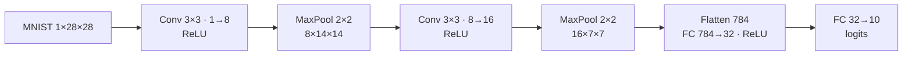
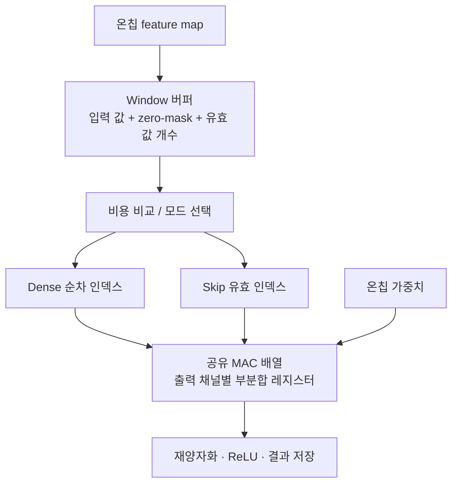

# MNIST CNN과 집중 설계 주제 제안

- 작성: 2026-10-13.
- 상태: **MNIST와 아래 CNN 구조는 확정, RTL 최적화는 논의용 후보**. 최신 결정·작업 순서는 [계획서](../../계획.md)의 1.4와 6장을 기준으로 한다.
- 기반: [기존 계획](../../계획.md), [논문 조사](../research/fpga-vision-literature-2026-10-13.md), [기술 트렌드](../research/fpga-vision-trends-2026-10-13.md).
- 목적: 작은 CNN으로 수치 정확성을 검증하면서, 제한된 FPGA 자원에서 입력의 희소성을 실제 처리시간 절감으로 연결하는 구조를 연구한다.
- dataflow는 output-stationary와 input-stationary scatter를 비교 후보로 둔다. 최종 방식은 학습·비용 분석 후 함께 선택한다.
- 현재 결과: 구조로부터 계산한 연산량·메모리 용량만 존재. 정확도·희소성·속도·자원·전력은 아직 측정하지 않았다.

## 1. 권장 주제

**MNIST용 소형 INT8 CNN의 입력 희소도에 따른 연산 스케줄 선택과 온칩 데이터 재사용.**

연구 질문:

> 동일한 CNN과 연산기 수에서, 0의 분포에 따라 dense/skip 실행을 선택하면 고정 방식보다 실제 추론 시간을 줄일 수 있는가? 추가 제어 비용과 가장 불리한 입력에서의 손해는 어느 정도인가?

- 핵심: 곱셈기를 멈추는 데 그치지 않고, 다음 유효 연산으로 넘어가 실제 실행 순서를 단축.
- 범위: Conv2 우선 평가, Conv1에도 같은 엔진 적용 가능성을 확인. FC는 초기 dense 실행.
- 보조 설계: 가중치·feature map 온칩 저장, 입력 재사용, 출력 부분합을 레지스터에서 유지.
- 저비트 혼합 정밀도·가지치기·early exit는 초기 연구 변수를 늘리지 않도록 후속 후보로 둔다.
- 신규성: zero-skipping·비트마스크·모드 선택 각각이 새로운 아이디어라고 주장하지 않는다. 구체적인 제어·메모리 구조의 비용과 비교 결과가 프로젝트 기여다.

근거: [HASS, FPL 2024](https://arxiv.org/abs/2406.03088)는 희소성과 하드웨어 비용의 공동 고려를, [FlexViT, FPL 2026](https://arxiv.org/abs/2606.31938)는 데이터 재사용과 실행 방식 전환을 다룬다. [NullHop](https://arxiv.org/abs/1706.01406)은 activation 희소성 가속의 선행연구다. 이 제안은 이들 논문에 제시된 회로를 그대로 복제한 것이 아니다.

## 2. 확정된 CNN 구조

아래 소형 CNN 구조로 학습 코드를 함께 작성하기로 했다. 정확도는 이후 학습으로 확인한다.



차원 표기는 C×H×W다. Conv stride 1, padding 1, Pool stride 2.

| 계층 | 가중치 수 | 명목 MAC/이미지 | 전체 MAC 비중 |
|---|---:|---:|---:|
| Conv1 | 72 | 56,448 | 18.35% |
| Conv2 | 1,152 | 225,792 | 73.39% |
| FC1 | 25,088 | 25,088 | 8.15% |
| FC2 | 320 | 320 | 0.10% |
| 합계 | 26,632 | 307,648 | 100% |

- MAC은 곱셈 후 누산 1회를 의미한다. 표는 padding을 포함한 규칙적 convolution의 명목 연산 수다.
- bias는 총 66개. 가중치 INT8 + bias INT32 저장량은 26,896바이트. scale·버퍼·복제·banking 비용은 별도다.
- 최대 INT8 feature map은 Conv1 출력 6,272바이트.
- 이론적 데이터 크기는 작지만 실제 BRAM 사용량은 폭·깊이·포트·banking·ping-pong 구성으로 증가한다.
- Conv2가 주요 연산 비용, FC1이 주요 가중치 저장 비용이다. 따라서 ‘가장 큰 레이어’를 판단할 때 지표를 구분한다.
- ReLU는 음수를 0으로 만든다. 그러나 bias·학습 결과에 따라 0 비율이 달라진다.
- MaxPool은 블록 내 양수 하나만 있어도 양수를 출력하므로, ReLU 직후의 0 비율을 Conv2 입력의 0 비율로 사용하면 안 된다.
- 입력은 [0,1] 스케일을 첫 후보로 사용. 배경 0을 유지한다. 일반 카메라 입력의 배경·노이즈가 같은 조건을 만족하는지는 별도 확인한다.
- 정확도 목표는 계획서 8.1을 따른다: float test accuracy 99% 이상, INT8 손실 0.3%p 이내. 아직 측정되지 않은 목표다.

## 3. 수치 형식

- 첫 기준: W8A8, zero point 0, INT32 누산.
- ReLU 출력은 기존 계획의 signed INT8 중 0~127 사용.
- 정확한 정수 0만 생략. 작은 비영 값을 임계값으로 버리는 근사는 초기 범위에서 제외.
- float↔INT8 오차와 Python 정수 기준↔RTL 일치 여부를 구분.
- bias·scale·rounding·saturation·overflow 규격은 정수 기준 구현 전에 명시.
- 비트 일치는 같은 양자화 모델의 dense/skip 간 목표다. float 모델과의 완전 일치를 뜻하지 않는다.
- INT32 중간 누산의 안전성을 확인하고, 최종 재양자화 전 불필요한 포화·절단을 하지 않는다.

## 4. 집중할 하드웨어 구조

### 4.1 출력 부분합을 가까이 유지하는 방식

첫 후보는 output-stationary 구조다.

- 한 출력 좌표의 입력 window를 로컬 버퍼로 가져온다.
- 입력 activation 하나를 여러 출력 채널의 MAC에 공유한다.
- 각 MAC은 자기 출력 채널의 부분합을 레지스터에 유지한다.
- 해당 출력 계산이 끝나면 bias·재양자화·ReLU를 적용하고 결과를 저장한다.
- 처음부터 큰 scatter 누산 메모리와 여러 쓰기 충돌을 다루는 부담을 줄이려는 선택이다.
- 기존 input-stationary scatter 후보는 입력 재사용 이점이 있으므로, 이 선택이 보편적으로 우월하다는 뜻은 아니다.

예시 병렬도 P=8:

- Conv1은 출력 채널 8개를 한 묶음으로 계산.
- Conv2는 출력 채널 16개를 두 묶음으로 계산.
- Conv2의 한 출력 좌표는 3×3×8=72개의 입력 항을 사용.
- 72개 값과 zero-mask를 두 출력 채널 묶음에 재사용하는 구조를 검토.
- 8개 MAC마다 한 개씩 가중치를 공급할 수 있는 메모리 폭/뱅크가 필요하다.
- P=8은 최초 설계 후보이며 DSP 사용량 8개나 8배 성능을 보장하는 수치가 아니다.

### 4.2 마스크와 dense/skip 실행



- Dense: 동일한 유효 kernel 영역의 항을 순서대로 계산.
- Skip: mask에서 0이 아닌 항의 인덱스를 얻고 대응 가중치와 계산.
- Adaptive: 현재 window의 유효 값 개수와 비용 추정으로 실행 모드를 선택.
- padding 위치는 dense와 skip 모두 같은 조건으로 처리한다. 고정적으로 알 수 있는 padding 제거를 입력 적응의 성과로 과장하지 않는다.
- mask는 window를 채우며 생성하는 후보를 먼저 고려한다. 별도 전처리로 만들면 그 시간을 포함한다.
- 큰 priority encoder 하나 또는 작은 그룹별 mask 중 선택은 timing·면적 결과를 보고 정한다.
- mask 생성은 데이터를 읽어야 가능하다. skip이 window 입력 읽기까지 자동으로 제거하지는 않는다.

### 4.3 선택 기준은 희소도 임계값 하나로 단정하지 않음

간단한 비용식은 다음과 같다. 실제 회로의 overlap과 stall을 반영해 보정한다.

```text
T_dense = T_window + T_sequential_compute + T_write
T_skip  = T_window_and_mask + T_index + T_nonzero_compute
          + T_memory_stall + T_write
T_auto  = T_selection + 선택한 경로의 시간
```

- 겹쳐 실행되는 단계는 단순 합이 아니라 실제 스케줄로 평가.
- Conv1과 Conv2는 입력 항 수와 출력 채널 묶음 수가 다르므로 같은 임계값이 최적이라고 가정하지 않음.
- 선택기는 mode 전환 비용까지 포함해 skip의 예상 이득이 충분할 때만 선택하는 후보.
- 마스크·선택 로직의 LUT·배선·주파수 비용은 dense 경로를 선택해도 남음.
- 따라서 “adaptive는 dense보다 절대 느리지 않는다”는 보장은 현재 없음.
- window별 선택의 비용이 크면 레이어별 고정 선택을 더 단순한 대안으로 비교.

## 5. 실험으로 무엇을 증명할 것인가

| 비교군 | 목적 |
|---|---|
| A. 단순 dense 전용 구현 | 추가 제어가 없는 기준의 자원·주파수·시간 |
| B. 제안 회로에서 dense 강제 | 공유 회로 안에서의 공정한 실행 모드 기준 |
| C. 제안 회로에서 skip 강제 | 무조건 생략하는 방식의 이득과 손해 |
| D. 제안 회로에서 adaptive | 선택 비용을 포함한 적응 실행의 효과 |

- B/C/D는 같은 모델·MAC 수·메모리 구조·목표 clock에서 비교.
- A와의 비교에서는 추가 LUT/BRAM와 구현 후 달성 주파수 차이까지 보고.
- 주요 지표: Conv2 cycle, 전체 CNN cycle, 실제 시간, LUT/DSP/BRAM, stall, 읽기/쓰기 수.
- 보조 지표: MAC 유효 가동률, 이미지별 0 비율, 평균/p95/최대 지연, 실측 가능할 때 추론당 에너지.
- 성능 개선 배율은 측정 전 약속하지 않는다.
- core cycle 향상이 카메라 표시 fps 향상과 동일하지 않으므로 ARM 전처리·전송·표시를 구분.
- MNIST 원본 test set이 공식 정확도·대표 성능 기준이다.
- 검증용 zero/random/dense tensor는 기능·최악 지연 실험용이며 MNIST 정확도 데이터에 섞지 않는다.
- sparse 효과는 Conv1과 Conv2를 나누어 제시. 검은 배경이나 padding에 의한 이득만으로 일반적인 중간 계층 효과를 주장하지 않는다.
- MNIST만 평가하므로 일반적인 모든 CNN에서의 우월성을 주장하지 않는다.

## 6. 단계별 판단 지점

1. **모델 학습·분포 확인**
   - train에서 validation을 분리. test는 최종 평가에 사용.
   - Float와 INT8 정확도, 입력/Pool1/Pool2의 정확한 0 비율과 window별 분포 기록.
   - 특히 Conv2가 실제로 보는 Pool1 출력을 검사.

2. **간단한 스케줄 비용 모델**
   - Python으로 계산 항 수만 세는 데 그치지 않고 window 읽기·mask·가중치 공급·누산 의존성을 포함.
   - 아직 RTL 실측이 아니므로 예상 cycle이라고 표기.
   - Conv2에서 절감 여지가 없다면 adaptive 희소 실행을 억지로 유지하지 않음.

3. **기본 RTL과 실측 보정**
   - dense와 정확한 정수 일치를 먼저 확보.
   - 동일 엔진에서 skip과 adaptive를 비교.
   - 예상과 실제 차이를 stall·timing·메모리 포트 단위로 분석.

4. **핵심 주제 확정**
   - 희소 실행이 이득이면 mask 단위·선택 정책·buffer 비용을 집중 최적화.
   - 이득이 작으면 온칩 재사용 또는 레이어별 저비트 비용을 대안 주제로 재논의.
   - 동일 MNIST를 유지하되 연구 질문은 실제 관측된 병목을 따라 좁힘.

## 7. 확정 사항과 다음 논의

- MNIST: 사용자 확정.
- CNN: 위의 8→16 채널 2-Conv와 FC 784→32→10 구조 확정. 변경이 필요하면 함께 재논의.
- 주제: 입력 희소도와 실행 비용을 반영한 dense/skip 선택을 최우선 후보로 권장.
- dataflow: 부분합을 레지스터에 유지하는 output-stationary 후보를 제안.
- 미확정: RTL 최적화 채택 여부, 최종 dataflow·병렬도, mask 그룹 크기, 선택 단위, 성능 개선 목표.
- 다음 작업: 학습용 Python 코드를 사용자와 단계별로 함께 작성한다. 실제 학습 설정·실행 시점도 함께 정한다.
- RTL 부분은 논의용이며 학습 코드·RTL 구현은 포함하지 않는다.

