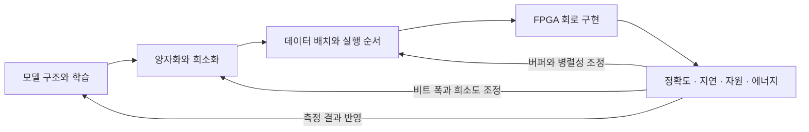

# FPGA 영상 AI 기술의 발전 방향과 트렌드

- **정리 기준:** 2026-10-13.
- **근거 범위:** [관련 논문 50편 조사](fpga-vision-literature-2026-10-13.md)의 2024–2026년 연구와 이전 핵심 연구.
- **대상:** FPGA에서 영상 신경망을 추론하는 기술. 일반 AI 전체나 FPGA 시장 점유율에 대한 보고서가 아님.
- **해석 범위:** 아래 방향은 선별한 논문에서 관측한 설계 주제의 종합이다. 분야 전체에서의 비중·성장률을 통계적으로 측정하지 않았다.
- **연대 해석:** 양자화·희소화·데이터 재사용·공동 설계는 오래된 개념이다. 최근에 처음 등장했다고 보거나, 이전 방식이 모두 대체됐다고 해석하지 않는다.
- **구분:** 논문에서 확인한 기술과 앞으로의 전망·우리 프로젝트 제안을 구분한다.

## 1. 큰 방향: 모델·수치 형식·데이터 흐름·회로를 함께 최적화

최근 사례들의 공통점은 정확도만 좋은 모델을 만든 뒤 FPGA에 옮기는 데 그치지 않고, 장치 제약을 모델 설계·양자화·실행 순서에 되돌려 반영한다는 점이다.

예를 들어 채널 수를 늘리면 정확도가 좋아질 수 있지만 BRAM을 넘어서 외부 메모리 접근이 늘 수 있다. 4비트로 줄이면 모델은 작아져도 정확도 복구나 비트 변환 회로가 필요할 수 있다. 따라서 한 지표만 최소화하는 대신 여러 가능한 설계 중 목적에 맞는 절충점을 찾는다.

이 피드백 구조의 서로 다른 부분을 다루는 사례가 [HASS](https://arxiv.org/abs/2406.03088), [HGQ-LUT](https://arxiv.org/abs/2604.22293), [ViM-Q](https://arxiv.org/abs/2605.01935), [FlexViT](https://arxiv.org/abs/2606.31938)다.

## 2. 기술별 발전 방향

아래의 ‘출발 관점’은 비교를 위한 단순화이며 특정 연대를 의미하지 않는다.

| 기술 축 | 출발 관점 | 최근 사례에서 확장되는 방향 | 발전을 촉진하는 문제 |
|---|---|---|---|
| 정밀도 | 모든 값을 같은 비트 수로 처리 | 레이어·채널·그룹별 정밀도, 공유 스케일, 값 분포에 맞춘 표현 | 비트를 줄이면 이상치와 작은 값의 오차가 커짐 |
| 희소성 | 0인 연산을 생략 | 압축·주소·레이어 균형까지 포함해 실제 실행 비용 최소화 | 0을 찾고 전달하는 비용, 연산기 사이의 작업 불균형 |
| 메모리 | 곱셈기를 병렬 배치 | 타일링·연산 융합·스트리밍·온칩 부분합 유지 | 외부 메모리 대역폭과 중간 결과 이동 |
| FPGA 자원 | DSP 중심 MAC 배열 | DSP와 LUT 분담, LUT에 맞춘 모델 학습 | DSP 수 제한과 저비트 연산의 특성 |
| 유연성 | 한 레이어 형태에 최적화 | 실행 중 데이터 재사용 방식·차원·해상도 설정 변경 | 레이어마다 행렬 크기와 병목이 다름 |
| 지원 연산 | Conv·FC·행렬곱 위주 | Softmax·정규화·상태 갱신·그래프 생성까지 포함 | 가속되지 않은 연산과 CPU 왕복이 전체 시간을 제한 |
| 설계 과정 | 수작업으로 구조·비트 폭 선택 | 하드웨어 비용을 넣은 탐색, 컴파일, 정수·RTL 일치 검증 | 선택지가 많아 수작업 탐색과 검증이 어려움 |
| 시스템 평가 | 코어의 최대 처리량 | 작은 배치 지연, 전체 추론 시간, 추론당 에너지 | 실제 장치의 응답성과 배터리·전력 제약 |

### 2.1 정밀도: 비트 수뿐 아니라 ‘값을 표현하는 방법’을 설계

- **관측:** HGQ-LUT는 세밀한 혼합 정밀도를 LUT 비용과 연결한다. Microscaling ViTs는 값 묶음이 스케일을 공유하는 MXInt 형식과 비선형 연산 회로를 다룬다.
- **왜 필요한가:** 4비트 정수로 큰 값과 작은 값을 동시에 정확히 표현하기 어렵다. 같은 비트 수라도 스케일·그룹·이상치 처리 방식에 따라 정확도와 회로 비용이 달라진다.
- **남는 문제:** 비트 변환, 스케일 저장, 반올림, 누산 폭이 추가된다. 낮은 비트 수가 곧 낮은 전체 비용은 아니다.
- **우리 적용:** INT8 기준을 만든 뒤 일부 레이어 W4A8 후보를 비교할 수 있다. 먼저 저장만 줄어드는지 실제 연산 자원도 줄어드는지 분리해서 확인한다.

근거: [HGQ-LUT, 2026](https://arxiv.org/abs/2604.22293), [Refining Datapath for Microscaling ViTs, FPL 2025](https://arxiv.org/abs/2505.22194).

### 2.2 희소성: 생략 가능한 연산을 실제 시간·에너지 절약으로 연결

- **관측:** HASS는 가중치·activation 희소성과 하드웨어 매핑을 공동 탐색한다. ExSpike는 SNN의 희소 이벤트를 압축하고 레이어 전체에서 이벤트 기반 실행을 유지한다.
- **왜 필요한가:** 서로 다른 연산기가 맡은 유효 값의 수가 다르면 일부만 바쁘고 나머지는 기다린다. 인덱스와 압축 해제도 비용이다.
- **남는 문제:** 입력에 따라 실행시간이 달라질 수 있고, 희소성이 낮으면 제어 비용이 이득을 넘을 수 있다.
- **우리 적용:** 평균 0 비율 외에 레이어별 분포·연속 길이·작업 불균형을 측정한다. 입력별 cycle 분포와 가장 느린 경우도 기록한다.
- **구분:** 정확히 0인 값을 생략하는 것과 작은 비영 값을 버리는 것은 수치 정확성 조건이 다르다.

근거: [HASS, FPL 2024](https://arxiv.org/abs/2406.03088), [ExSpike, FPL 2026](https://arxiv.org/abs/2606.20414).

### 2.3 데이터 이동: 저장 위치와 처리 순서가 아키텍처의 핵심

- **관측:** FlexViT는 부분합을 온칩에서 완성하는 타일링과 입력/가중치 재사용 전환을 사용한다.
- **왜 필요한가:** 연산기 수를 늘려도 메모리 공급량이 부족하면 기다리는 시간이 늘어난다. 부분합을 외부 메모리로 반복 전송하면 대역폭을 소모한다.
- **남는 문제:** 큰 타일은 메모리 이동을 줄이지만 BRAM을 더 사용한다. 병렬 경로가 많아지면 메모리 포트·배선이 제한이 된다.
- **우리 적용:** 작은 CNN은 가중치와 특징을 온칩에 둘 수 있으므로, 외부 DDR 절감보다 BRAM 읽기·쓰기·포트 충돌과 Conv→ReLU→Pool 버퍼를 우선 본다.

근거: [FlexViT, FPL 2026](https://arxiv.org/abs/2606.31938).

### 2.4 LUT 활용: 학습한 함수를 FPGA 논리 자원에 맞추기

- **관측:** TLMAC는 양자화된 MAC을 soft logic에서 처리한다. HGQ-LUT는 LUT 계층을 학습하고 기존 산술 계층과 섞어 RTL로 변환한다.
- **왜 필요한가:** 모든 연산을 DSP로 구현하는 것이 해당 비트 폭에서 가장 효율적인 선택이라고 보장할 수 없다.
- **남는 문제:** lookup 입력 비트가 늘면 경우의 수가 지수적으로 증가한다. LUT 사용량·배선·주파수와 학습 비용이 문제가 된다.
- **우리 적용:** 특정 작은 연산을 LUT로 옮기는 것과 모델 전체를 LUT 기반으로 바꾸는 것을 구분한다.
- **연구 단계:** 유망한 특화 연구 축이다. 일부 물리학 벤치마크의 초저지연 결과를 대규모 영상 모델의 일반적 대체 기술로 해석하지 않는다.

근거: [TLMAC, FPGA 2024](https://arxiv.org/abs/2403.11414), [HGQ-LUT, 2026](https://arxiv.org/abs/2604.22293).

### 2.5 유연성: 레이어마다 다른 병목에 대응하는 회로

- **관측:** FlexViT는 입력 재사용과 가중치 재사용 모드를 전환한다. ViM-Q는 모델 차원·해상도에 대응하는 실행 중 설정을 지원한다.
- **왜 필요한가:** 채널 수·행렬 크기·입력 해상도가 달라지면 같은 병렬 구조의 활용률이 달라진다.
- **남는 문제:** 설정·선택 회로와 제어가 자원을 사용한다. 하나의 고정 모델만 돌린다면 더 단순한 전용 회로가 유리할 수 있다.
- **우리 적용:** 최초 구현에 광범위한 범용성을 넣기보다 실제 레이어 차이에 필요한 최소한의 설정만 고려한다.
- **용어 주의:** 여기서 실행 중 설정 변경은 반드시 FPGA 비트스트림을 다시 쓰는 동적 부분 재구성을 의미하지 않는다.

근거: [FlexViT](https://arxiv.org/abs/2606.31938), [ViM-Q](https://arxiv.org/abs/2605.01935).

### 2.6 모델 다양화: 모델에 고유한 병목을 함께 처리

- **ViT:** attention의 Softmax·정규화 등.
- **Vision Mamba:** 상태 갱신과 스트리밍에 맞는 실행 순서.
- **Vision GNN:** 이웃 그래프를 만드는 처리와 특징 연산의 연결.
- **관측:** Microscaling ViTs, ViM-Q, GraphLeap이 각각 이 문제를 다룬다.
- **해석:** CNN→ViT→Mamba가 단일 교체 순서라는 뜻은 아니다. 모델 계열이 병존하면서 각 모델에 맞는 가속기 설계가 연구되고 있다.
- **우리 적용:** 최신 모델을 선택한다면 새로 필요한 연산의 RTL·검증 비용까지 포함해 판단한다. 모델 이름의 최신성이 가속기의 기여를 보장하지 않는다.

근거: [Microscaling ViTs](https://arxiv.org/abs/2505.22194), [ViM-Q](https://arxiv.org/abs/2605.01935), [GraphLeap](https://arxiv.org/abs/2604.21290).

### 2.7 자동화: 모델에서 회로와 검증까지 연결

- **관측:** HASS는 하드웨어 비용을 포함한 희소성 탐색을 수행한다. HGQ-LUT는 학습·컴파일·bit-exact 검증을 연결한다.
- **왜 필요한가:** 채널 수, 비트 폭, 병렬성, 버퍼 크기를 동시에 고르면 가능한 조합이 많다.
- **남는 문제:** 탐색에 쓰는 비용 예측이 실제 합성·배치배선 결과와 다를 수 있다. 지원하지 않는 연산과 도구 의존성도 존재한다.
- **우리 적용:** 직접 RTL을 작성하더라도 Python에서 가중치·스케일·레이어 규격·golden output을 같은 정의로 생성하는 접근이 유용하다. 자동 생성된 값도 RTL과 검증해야 한다.

근거: [HASS](https://arxiv.org/abs/2406.03088), [HGQ-LUT](https://arxiv.org/abs/2604.22293).

### 2.8 시스템 목표: 목적에 따라 다른 최적점을 선택

- **관측:** FlexViT는 가속 대상 레이어 향상과 전체 향상을 구분한다. ViM-Q는 낮은 배치 조건에서 평가한다.
- **해석:** 실시간 카메라 장치에서 필요한 것은 처리할 영상이 쌓인 상태의 최대 처리량뿐 아니라 한 입력에 대한 응답시간과 추론당 에너지다.
- **남는 문제:** 측정 시작점, CPU 포함 여부, 보드 전력과 칩 전력, 실측과 도구 추정을 맞춰야 비교할 수 있다.
- **우리 적용:** 30fps 입력이면 프레임 간격은 약 33.3ms다. 이 예산을 만족한 다음 더 빠른 코어, 더 적은 자원, 더 낮은 에너지 중 무엇을 주목표로 삼을지 정한다.
- **주의:** 최소 지연·최소 자원·최소 에너지는 서로 다른 설계를 선택하게 할 수 있다.

근거: [FlexViT](https://arxiv.org/abs/2606.31938), [ViM-Q](https://arxiv.org/abs/2605.01935). 30fps는 현재 프로젝트 계획을 기준으로 한 설명이다.

## 3. 무엇이 확립된 기반이고, 무엇이 탐색 중인가

아래 구분은 이번 조사에 근거한 실무적 해석이며 시장 보급률 판정이 아니다.

| 구분 | 기술 | 우리에게 의미하는 것 |
|---|---|---|
| 오래된 기반 | INT8, 타일링, 데이터 재사용, 기본 zero-skipping | 구현에 필요하지만 채택 자체로는 차별점이 약함 |
| 구체적 설계가 활발한 축 | 하드웨어 비용을 반영한 혼합 정밀도·희소성, 연산 융합, 레이어별 설정 | 제한된 자원에서 비용과 효과를 비교할 주제로 적합 |
| 특화 과제에서 탐색되는 축 | LUT 기반 모델, SNN 이벤트 처리, Vision Mamba·GNN 가속 | 장점과 함께 모델·데이터·하드웨어 조건을 검토해야 함 |

각 기술의 보급 정도나 성능 우열을 일괄 순위로 매길 근거는 이번 조사에 없다.

## 4. 앞으로의 발전 방향 — 전망

아래는 확인된 결과 자체가 아니라 위 연구들을 종합한 전망이다.

1. **정밀도·희소성·데이터 흐름의 공동 선택**
   - 각각 따로 최적화하면 다른 곳에서 생기는 비용을 놓칠 수 있다.
   - 따라서 정확도와 실제 자원 제약을 함께 만족하는 조합을 탐색하는 방향이 이어질 것으로 본다.

2. **여러 연산 방식을 섞는 구조**
   - DSP 산술, LUT 논리, 시프트·덧셈, CPU 처리를 연산 특성에 따라 분담하는 설계가 중요해질 수 있다.
   - 비용을 상쇄할 만큼 활용률이 높아야 하므로 모든 설계에 이로운 것은 아니다.

3. **입력 변화에 대응하면서 지연을 관리하는 실행**
   - 희소도·해상도·활성 토큰 수가 달라지는 작업에서는 고정 실행의 낭비를 줄일 여지가 있다.
   - 실시간 시스템에서는 평균 속도와 함께 최악 지연·버퍼 상한을 관리하는 설계가 필요하다.

4. **도구의 자동화와 재현 가능한 검증**
   - 더 복잡한 수치 형식과 이종 연산을 쓰면 모델과 RTL의 일치 검증 부담이 증가한다.
   - 따라서 변환·검증을 함께 제공하는 흐름의 가치가 커질 것으로 본다.

이 전망은 “FPGA가 GPU를 보편적으로 대체한다”, “CNN이 사라진다”, “모든 연산이 4비트가 된다”는 예측을 뒷받침하지 않는다. 그런 주장을 위한 비교·시장 자료는 조사하지 않았다.

## 5. 우리 프로젝트에 반영할 우선순위

| 우선순위 | 반영할 내용 | 먼저 필요한 근거 |
|---|---|---|
| 1 | 비교 가능한 정수 기준 모델과 측정 체계 | float/INT8 정확도, 레이어별 golden output |
| 2 | 데이터 이동과 자원 예산을 포함한 기본 구조 | 레이어별 MAC·메모리 크기·읽기/쓰기량 |
| 3 | 희소성 또는 저비트 중 핵심 주제 하나 선택 | activation 분포 또는 저비트 정확도 실험 |
| 4 | 기본 방식과 제안 방식의 차이를 검증 | cycle·주파수·자원·정확도·에너지 |
| 확장 | 실행 중 설정, LUT 특화 연산, 두 번째 모델 | 첫 구현의 관측된 병목과 남은 자원 |

**제안하는 연구 질문:** “제한된 온칩 메모리와 연산 자원에서, 데이터의 희소성 또는 정밀도를 활용해 정확도를 유지하면서 실제 처리 비용을 얼마나 줄일 수 있는가?”

이 질문은 모델을 학습하고 분포를 확인한 뒤 더 좁혀야 한다. 현재 단계에서는 희소성과 저비트를 모두 넣거나 모델을 ViT로 교체하는 결정을 내리지 않는다.

