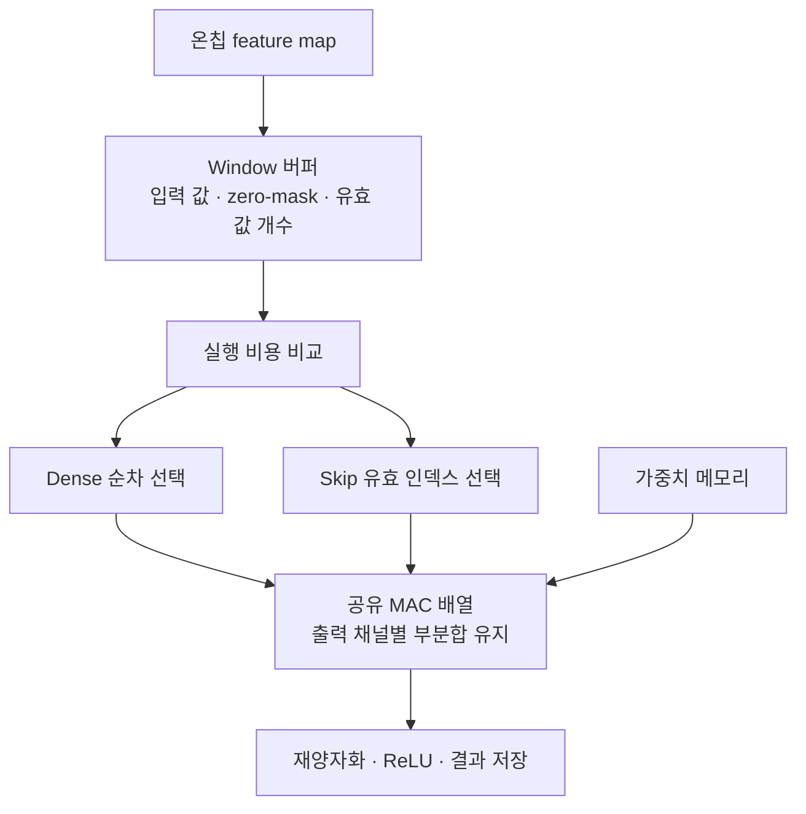

# 실시간 ROI 숫자 분류 CNN 가속기 설계 계획서

## 1. 개요

### 1.1 목적과 결과물

- **목적:** Zynq 보드에서 직접 설계한 CNN 가속기로 카메라 입력 숫자를 실시간 분류.
- **결과물:** 실제 보드 동작, 시연 영상, 발표 자료, 보고서, GitHub 소스(`Hazzzelnut12/cnn_accelerator`).
- **평가 관점:** 완성도·직접 설계 비중 우선. 동일 CNN에서 RTL 최적화가 만드는 정확도·시간·자원·전력의 차이를 비교(6.6).
- **완료 기준:** 자체 RTL의 실제 보드 실행, ROI 숫자 분류 화면, 정수 일치 검증, 성능·자원·timing 보고, 영상·발표·보고서.

### 1.2 과제 범위

| 구분 | 내용 |
|---|---|
| 포함 | 키트 카메라 입력, 화면 중앙 고정 ROI 안의 숫자 1개를 0~9로 분류 |
| 화면 | 키트 LCD에 카메라 영상 + ROI 테두리 + 예측 숫자 + 신뢰도 표시 |
| 정량 평가 | MNIST 공식 test set 10,000장 (accuracy·confusion matrix) |
| 정성 시연 | 직접 쓴 손글씨를 카메라로 촬영. 정량 수치와 분리 |
| 제외 | 여러 숫자·객체 탐지(mAP), ROI 이동·크기 UI, 실행 중 모델·가중치 교체, Vitis AI DPU 사용 |
| 확장 후보 | QAT, Winograd, 소형 ResNet, 가중치 교체 경로, 전처리 PL 이관 |

### 1.3 핵심 설계 결정

모델 선택 근거는 4.2.

| 항목 | 결정 |
|---|---|
| 데이터셋 | MNIST 확정. train/validation으로 개발하고 공식 test로 최종 평가 |
| 모델 | 4.1의 2-Conv CNN 확정: 채널 1→8→16, FC 784→32→10. 구조 변경이 필요하면 함께 재논의 |
| 가속 범위 | Conv·ReLU·Pool·FC 전 layer PL 실행, logit 10개 출력. 시간 부족 시에만 FC를 ARM으로 후퇴 |
| 수치 형식 | signed INT8, zero point 0, INT32 누산 |
| RTL 차별화 | 학습·분포 분석 후 선택. 우선 후보는 비용을 고려한 dense/skip 적응 실행, 대안은 데이터 재사용·혼합 정밀도(6.4~6.7) |
| HW 구현 | 직접 작성한 Verilog RTL. HLS 미사용 |
| ARM 역할 | standalone C: 장치 초기화·전처리·가속기 제어·Softmax·표시 |
| 도구 | Windows + Vivado/Vitis 2025.2, Vivado Simulator |
| 학습 | PyTorch, uv venv + Python 3.12, 로컬 RTX 4060 Ti (대안 Colab) |
| 작업 순서 | 계획 정리 → 학습 코드 함께 작성 → 학습·분포 분석 → PTQ·정수 reference → RTL 최적화 선택·규격화 → golden trace·RTL |

### 1.4 확정 범위와 협업 순서

- **확정:** MNIST와 4.1의 CNN 구조. 하드웨어 최적화 선택 전에도 기본 float 모델을 학습할 수 있음.
- **학습 후 선택:** RTL dataflow, dense/skip 선택 정책, 병렬도, 마스크 단위, 메모리 banking. 학습된 값의 분포와 예상 실행 비용을 근거로 함께 결정.
- **현재 상태:** 사용자가 10 epoch 기준 실험 완료. 최고 검증 정확도 98.48%, 해당 모델의 test 정확도 98.63%. [기준 결과](artifacts/mnist/20261013-200109-554603/results.json).
- **다음 작업:** epoch만 20으로 늘려 사용자가 직접 실행·비교. batch 64·Adam lr 0.001·seed 42·증강 없음 유지. [실행 방법](README.md). 기존 모델에서 이어 학습하지 않고 처음부터 20 epoch 실행.
- **추가 학습 가능성:** 추후 저비트 양자화·가지치기를 선택하면 보정 또는 재학습이 필요할 수 있음. 최초 float 모델을 비교 기준으로 보존.

## 2. 개발 환경

### 2.1 보드 사양

Libertron AI Starter Kit v2.1.

| 항목 | 사양 |
|---|---|
| FPGA | XC7Z020-1CLG484 (Vivado part `xc7z020clg484-1`) |
| PS | ARM Cortex-A9 dual core |
| PL 자원 | LUT 53,200 · FF 106,400 · DSP 220 · BRAM 36Kb×140 (약 4.9Mbit) |
| DDR3 | 512MB, 32-bit, 최대 1066MT/s |
| Clock source | PS 33.333MHz, PL 100MHz. CNN clock은 Clock Wizard·STA 결과로 결정 |
| 카메라 | 1920×1080 30fps, parallel, decoder TP2825B, I2C 초기화, YUV422 → RGB 변환 |
| LCD | 7인치 800×480, RGB888, 최대 60fps |
| 기타 출력 | HDMI 1080p60, VGA QXGA/60Hz (카메라 입력 해상도와 무관) |
| PC 접속 | USB JTAG(다운로드), USB UART(로그) |
| 부팅 | JTAG, QSPI, SD card |
| 전원 | 12V/3A adapter (정격 36W, 실제 소비전력과 구분) |

### 2.2 개발 도구·SW 환경

| 항목 | 내용 |
|---|---|
| Vivado | 2025.2, `D:\Xilinx\2025.2\Vivado\bin\vivado.bat` |
| Vitis | 2025.2 Unified, `D:\Xilinx\2025.2\Vitis\bin\vitis.bat`. ARM standalone 앱·BSP 빌드 |
| Python | 프로젝트 `.venv`: uv 0.13.0, Python 3.12.15, torch 2.11.0+cu128, torchvision 0.26.0+cu128, `uv.lock` 고정. 시스템 Python 3.14는 사용 안 함 |
| GPU | RTX 4060 Ti 8GB, CUDA 순전파·역전파·가중치 갱신 검증 완료([결과](docs/validation/environment.json)) |
| Vivado batch 실행 | Tcl 초기화 실패 시 `XILINX_LOCAL_USER_DATA=NO`, `XILINX_TCLAPP_REPO=D:/Xilinx/2025.2/Vivado/data/XilinxTclStore` 지정 |

## 3. 시스템 구조

### 3.1 전체 데이터 경로와 PS/PL 분담

```text
[영상 경로]  camera → TP2825B → crop(필요 시 resize) → frame buffer(DDR) → overlay → LCD
[추론 경로]  ROI → (ARM) 전처리 → 28×28 INT8 → AXI BRAM → (PL) CNN → logit 10개 → (ARM) Softmax → overlay
```

| 구분 | 담당 |
|---|---|
| PL (직접 설계) | CNN 전체: MAC·누산, Conv 주소 생성, ReLU, Pool, 재양자화, FC, 계층 제어 |
| PL (표준 IP) | PS7, AXI interconnect, BRAM, FIFO, Clock Wizard, reset, 영상 frame buffer |
| PS (ARM C) | camera·LCD 초기화, ROI 전처리, 가속기 제어, Softmax, 결과 표시 |

### 3.2 카메라·ROI·표시

- **ROI:** 화면 중앙 고정 정사각형. 크기·좌표는 전처리 실험으로 결정.
- **전처리(ARM):** grayscale → 배경·명암 정리 → 숫자 영역 추출 → 종횡비 유지 resize → 28×28 중심 정렬. 목표는 MNIST와 같은 형태(검은 배경·흰 숫자, 크기·위치). CPU에서 시작하고, 병목이 확인되면 PL 이관을 검토.
- **grayscale:** 초기에는 예제의 RGB에서 변환, 안정화 후 Y 성분 직접 사용 검토.
- **빈 ROI 판정:** foreground 양·크기로 판정. Softmax 최대값만으로 판단하지 않음.
- **표시:** 예측 숫자, 신뢰도 %(Softmax 점수, 정답률 아님), "입력 없음" 상태.
- **초기 시연 조건:** 흰 종이, 검은 숫자, 정해진 거리, ROI 안에 숫자 하나.

### 3.3 실시간성·프레임 제어

- camera 30fps 기준 frame 주기 33.3ms. 전처리·전송·추론을 이 안에 여유 있게 처리.
- 영상 표시와 CNN 경로를 분리해 추론 지연이 화면을 멈추지 않게 함.
- ROI buffer는 ping-pong, frame buffer는 tearing 검증 후 double/triple buffer 결정.
- frame ID로 수신·추론·표시를 연결하고, 수신·완료·drop 수를 counter로 기록.
- 과부하 시 최신 ROI 우선, 대기열 상한 적용(무제한 대기열 금지).
- 표시 fps와 분류 fps는 따로 측정.

## 4. CNN 모델

### 4.1 구조와 연산량

**확정 구조:** 아래의 2-Conv CNN. 입력 28×28×1 grayscale, [0,1] scale 적용(평균 차감 미사용으로 배경 0 유지). 추론 batch 1이며 학습 batch 크기는 별도 결정. zero-skip의 실제 이득은 학습·RTL 평가로 확인.

| Layer | 구성 | 출력 | MAC/image | 가중치 |
|---|---|---|---:|---:|
| Conv1 | 3×3, 1→8, stride 1, pad 1, ReLU | 28×28×8 | 56,448 | 72 |
| Pool1 | 2×2 max, stride 2 | 14×14×8 | – | – |
| Conv2 | 3×3, 8→16, stride 1, pad 1, ReLU | 14×14×16 | 225,792 | 1,152 |
| Pool2 | 2×2 max, stride 2 | 7×7×16 | – | – |
| FC1 | 784→32, ReLU | 32 | 25,088 | 25,088 |
| FC2 | 32→10 | 10 (logit) | 320 | 320 |
| **합계** | | | **307,648** | **26,632** |

- 모든 layer bias 포함 → 파라미터 26,698개. INT8 가중치 약 26KiB.
- Conv가 MAC의 약 91.7%, **Conv2 단독으로 약 73.4%**. Conv2를 우선 최적화 대상으로 검토.
- FC1은 가중치의 약 94.2%를 차지. 연산 병목과 저장 용량의 비중을 구분.
- 최대 INT8 중간 feature map은 Conv1 출력 6,272byte. 가중치 INT8 + bias INT32는 26,896byte(scale·buffer 제외).
- 데이터 크기를 기준으로 온칩 저장을 목표로 함. 실제 BRAM 사용량은 banking·복제·ping-pong·부분합 및 영상 회로를 포함해 합성으로 확인.
- Softmax는 ARM에서 출력 scale로 dequantize 후 계산.

### 4.2 모델 선택 근거

- **LeNet 파생 선택:** 작은 입력·적은 층·단순 제어, 전체 on-chip 저장 가능. 다채널 Conv·MAC 병렬화·pooling·양자화 등 가속기 핵심 설계 요소는 모두 포함.
- **ResNet18 제외:** 파라미터 10.66MB vs BRAM 약 612KB, 약 1.8GMAC, DDR tiling 필수 → 일정 내 자체 RTL 불가. 제조사 예제도 Linux·Vitis AI·DPU 기반이라 자체 RTL과 무관.
- **소형 ResNet:** on-chip 구동은 가능하나 residual 경로(skip 보관·add·scale 정렬) 작업량 대비 MNIST 정확도 이득이 작아 확장 후보로 둠.
- **Winograd F(2×2,3×3):** 곱셈 2.25배 감소·bit-exact 가능하나 DSP가 병목이 아니고, 카메라 30fps가 병목이며, Conv1은 Cin=1이라 실이득이 작음 → 후순위.
- **차별화:** 모델은 고정하고 RTL의 실행 순서·데이터 재사용·제어 비용을 비교. 특정 기법의 채택 자체보다 실제 개선과 추가 비용을 제시(6.4~6.7).

### 4.3 학습·데이터 관리

| 데이터 | 용도 |
|---|---|
| MNIST train 60,000 | 학습. 일부를 validation으로 분리 |
| validation | 모델 선택, PTQ calibration, threshold 조정 |
| MNIST test 10,000 | float·INT8·RTL·실보드 정확도 비교 기준. 튜닝에 사용 금지 |
| 손글씨 촬영 | 전처리 개발·시연용. 정량 평가에 사용 안 함 |

- 증강: 작은 이동·회전·크기·밝기·획 변화(숫자 의미가 바뀌는 변환 제외).
- 재현 정보 기록: seed, split, 증강, optimizer, learning rate, batch size, epoch, checkpoint, SW 버전.
- 산출물: float checkpoint, 정수 parameter, scale·bias, 구조 정의, golden trace, 평가 결과.

### 4.4 RTL 선택에 필요한 학습 결과

- **정확도:** float와 INT8 각각 기록. 정수 reference와 RTL의 수치 일치 검증은 별도.
- **관측 위치:** 원본 입력, ReLU1, Pool1(Conv2 입력), ReLU2, Pool2(FC1 입력).
- **분포:** 정확한 0의 비율, 채널별·이미지별 차이, window별 유효 값 개수, 0의 연속 길이, 값의 범위.
- **Pool 영향:** MaxPool 창 안에 양수가 하나라도 있으면 양수를 출력하므로 ReLU1의 희소도를 Conv2 입력 희소도로 대신 사용하지 않음.
- **양자화 영향:** float의 0 비율과 INT8의 0 비율을 각각 측정. 최종 정수 RTL의 비용 예측에는 INT8 분포 사용.
- **데이터 분리:** 모드 선택 정책·비용 모델 조정에는 train/validation 사용. test는 정책을 고정한 후 최종 정확도·성능 평가에 사용.

## 5. 양자화·정수 규격

- **방식:** PTQ 우선. INT8 손실이 크거나 여유가 있을 때 QAT 비교.
- **Weight:** signed INT8, symmetric, zero point 0, layer별 scale(필요 시 output-channel별 검토).
- **Activation:** signed INT8, zero point 0. ReLU 이후 0~127만 사용. 정수 0 = 실수 0이므로 zero-skip은 정수 0 비교로 판정.
- **Bias·누산:** INT32. layer별 최악값으로 overflow 여부 확인.
- **재양자화:** 정수 multiplier + shift + rounding + saturation. power-of-two scale 강제는 안 함.
- **확정해야 할 규격:** multiplier 비트폭, rounding tie 규칙, shift, saturation 범위, bias scale.
- **데이터 layout:** feature map CHW, weight `[out][in][ky][kx]`, FC flatten CHW. byte packing·endianness 명시.
- **일치 원칙:** Python 정수 reference·ARM C·RTL이 같은 식·순서·rounding을 사용. framework의 INT8 결과와 자동으로 일치한다고 가정하지 않음.
- **오류 분리:** float→INT8 정확도 손실과 정수 reference→RTL 불일치를 따로 추적.

## 6. 가속기 RTL 설계

### 6.1 연산 엔진과 dataflow 후보

- **기본 후보:** pipelined MAC을 가진 Conv 엔진을 layer 간 재사용. direct 3×3, stride 1, padding 1. 최종 dataflow는 학습·비용 분석 후 선택.
- **output-stationary 후보:** 한 출력 좌표의 입력 window를 버퍼에 두고, 입력 하나를 여러 출력 채널의 MAC에 공유. 채널별 부분합을 레지스터에 유지해 반복 쓰기와 충돌을 줄이는 방향.
- **input-stationary scatter 후보:** 입력 activation을 중심으로 영향을 받는 출력에 누산. 입력 재사용 이점과 부분합 메모리의 접근·쓰기 충돌 비용을 함께 검토. 기존에 고정했던 방식을 비교 후보로 전환.
- **병렬도 예시:** MAC 8개이면 Conv1 출력 8채널을 한 묶음, Conv2 출력 16채널을 두 묶음으로 처리하는 후보. 최종 병렬도는 미확정이며 DSP 개수·성능 배율을 보장하지 않음.
- **가중치 공급:** MAC 병렬도에 맞춘 메모리 폭·banking과 포트 제약을 포함해 평가.
- **적용 범위:** Conv2를 우선 분석하고 Conv1 효과를 별도 확인. FC는 초기 dense 실행을 기준으로 두고 재사용 가능성을 검토.
- **성능 표현:** MAC/clock, image당 cycle, utilization. 연산기 수만으로 실제 처리량을 단정하지 않음.

### 6.2 메모리·dataflow

- **BRAM:** weight·feature map 상주, 입력 ping-pong 목표. 부분합의 register/BRAM 배치는 dataflow 선택에 따라 결정.
- **가중치 공급:** BRAM 초기화 또는 ARM 초기 로드. 매 추론마다 재전송하지 않음.
- **입력:** AXI memory-mapped BRAM에 INT8 784byte. DMA는 전송 시간을 측정한 뒤 필요하면 추가.
- **DDR:** 영상 frame buffer 전용. CNN 중간 feature map의 DDR traffic 0 목표.
- **평가:** weight·input 반복 read, partial sum 이동, banking 충돌 비교.
- CPU와 DMA가 DDR을 공유하면 cache clean/invalidate·buffer 소유권 검증.

### 6.3 제어 인터페이스

- **Register:** start, busy, done, error, layer 상태, cycle counter, frame ID. 적응형 실행을 선택하면 dense 강제 / skip 강제 / adaptive 모드 추가.
- **Protocol:** busy 중 start, reset, 완료 전 output 접근, 입력 덮어쓰기에 대한 동작 규칙 명시.
- **Debug:** simulation trace, 보드 상태 register, 필요 시 ILA.

### 6.4 RTL 차별화 후보와 우선순위

| 후보 | 연구 질문 | 학습 후 확인할 근거 | 현재 상태 |
|---|---|---|---|
| 비용을 고려한 dense/skip 적응 실행 | 0 검사·인덱스·메모리 비용을 포함해 실행시간을 줄일 수 있는가? | 특히 Pool1 출력의 window별 희소성, 레이어별 예상 cycle | 최우선 검토 후보, 채택 미확정 |
| 온칩 데이터 재사용·연산 연결 | 입력·가중치·부분합의 읽기/쓰기와 중간 버퍼를 줄일 수 있는가? | 메모리 접근 수, 포트 충돌, buffer 용량 | 기본 설계에서 검토하며 독립 주제로도 선택 가능 |
| 레이어별 혼합 정밀도 | 일부 W4A8 처리로 정확도를 유지하며 실제 자원·시간을 줄일 수 있는가? | 저비트 정확도, packing·변환 비용, DSP/LUT 매핑 | 후속 또는 대안 후보 |

- **집중 범위:** 모든 기법을 동시에 넣지 않고 관측된 병목에 맞춰 핵심 주제 하나를 선택.
- **최신 연구와의 연결:** 희소성·정밀도만 줄이는 데 그치지 않고 데이터 이동·제어·회로 자원까지 함께 최적화하는 방향.
- **기여의 기준:** zero-skipping·마스크·모드 선택 자체의 신규성을 주장하지 않음. 구체적인 구조, 단순 기준 대비 개선, 추가 비용, 효과가 없는 조건을 제시.
- **관련 조사:** [논문 50편](docs/research/fpga-vision-literature-2026-10-13.md), [기술 발전 방향](docs/research/fpga-vision-trends-2026-10-13.md), [상세 설계 논의](docs/design/mnist-cnn-proposal.md).

### 6.5 최우선 후보: 비용을 고려한 적응형 희소 실행

**연구 질문:** 같은 CNN·MAC 수에서 입력의 0 분포를 보고 실행 방식을 선택하면, 고정 방식보다 실제 추론 비용을 줄일 수 있는가?

| 실행 모드 | 동작 |
|---|---|
| Dense | 입력 항을 순서대로 계산 |
| Skip | 정확히 0인 항을 생략하고 다음 유효 인덱스로 진행 |
| Adaptive | 유효 값 개수와 실행 비용 추정으로 dense/skip 선택 |



- **마스크:** 0이 아닌 값의 위치를 비트로 기록. window를 채우며 생성하는 후보를 검토하고, 별도 생성 시 그 시간을 포함.
- **재사용:** Conv2의 한 출력 좌표는 3×3×8=72개 입력 항을 사용. P=8 예시에서는 값·마스크를 두 출력 채널 묶음에 재사용하는 후보.
- **실제 생략:** 0일 때 MAC만 정지시키는 방식은 cycle 단축과 구분. 다음 유효 연산으로 진행하는 스케줄을 설계.
- **비용 모델:** window 읽기, mask 생성, 유효 인덱스 탐색, 가중치 공급, 계산, stall, 모드 선택·전환, 결과 쓰기를 포함. 단계 중첩을 반영하고 RTL 측정으로 보정.
- **수치 일치:** 같은 INT8 모델의 dense/skip/adaptive 결과가 정수 reference와 bit-exact인 것이 목표. 누산 overflow·반올림·포화 규칙 확인.
- **입력 읽기:** 0인지 알려면 입력을 읽어야 하므로 skip이 모든 메모리 접근을 제거한다고 가정하지 않음.
- **최악 조건:** 희소도가 낮아도 선택기·마스크의 자원 비용은 남음. adaptive가 항상 dense보다 빠르다고 보장하지 않음.
- **선택 단위:** window별 선택과 더 단순한 레이어별 고정 선택을 비교. 마스크 그룹 크기·임계값은 미확정.
- **후퇴 조건:** Conv2 입력의 희소성이 부족하거나 제어 비용이 크면 적응 실행을 필수로 유지하지 않고 6.4의 다른 후보를 함께 재논의.

### 6.6 비교 실험과 차별점 검증

적응형 희소 실행을 선택할 경우 다음 네 가지를 비교한다.

| 비교군 | 확인할 내용 |
|---|---|
| A. 단순 dense 전용 회로 | 추가 제어가 없는 기준의 자원·주파수·실행시간 |
| B. 제안 회로에서 dense 강제 | 마스크·선택 로직을 포함한 회로의 기준 비용 |
| C. 제안 회로에서 skip 강제 | 무조건 생략하는 방식의 이득과 손해 |
| D. 제안 회로에서 adaptive | 모드 선택 비용을 포함한 적응 실행의 효과 |

- **공정성:** B/C/D는 같은 모델·MAC 수·메모리 구조·clock에서 비교. A와는 같은 연산 자원 예산을 기준으로 추가 LUT/BRAM와 실제 달성 주파수 차이도 보고.
- **주요 측정:** Conv2·전체 CNN cycle, 실제 지연, LUT/FF/DSP/BRAM, timing, stall, 메모리 읽기/쓰기.
- **입력별 측정:** 평균·p95·최악 지연, 0 분포와 성능의 관계, 선택된 모드 비율. 전력은 실측/추정과 측정 범위를 명시.
- **padding 통제:** 모든 비교군이 고정 padding을 같은 조건으로 처리. 알려진 padding 제거를 입력 적응의 효과로 과장하지 않음.
- **계층 분리:** Conv1의 검은 배경 효과와 Conv2 중간 특징의 희소성 효과를 분리.
- **평가 범위:** MNIST test로 대표 성능을 평가. 별도 dense/random/zero 입력은 기능·최악 지연 검증용이며 정확도 평가에 섞지 않음.
- **주장 범위:** MNIST 결과를 모든 CNN의 성능 향상으로 일반화하지 않음. 측정 전 가속 배율을 확정하지 않음.

### 6.7 학습 후 RTL 최적화를 선택하는 순서

1. 확정된 CNN의 float 모델을 학습하고 validation으로 4.4의 분포를 분석.
2. INT8 변환·정수 reference를 준비하고 양자화 후 분포를 재확인.
3. 연산 수뿐 아니라 제어·메모리·stall을 포함한 비용 모델로 6.4 후보를 비교. 예측은 실측과 구분.
4. 분석 결과를 함께 검토해 핵심 최적화·dataflow·병렬도·수치 규격을 선택.
5. dense RTL의 수치 일치를 확보한 뒤 선택한 기법을 추가하고 실측으로 비용 모델을 보정.
6. 효과가 부족하면 원인을 분석하고 선택을 재논의. 기본 학습 모델과 dense 결과는 비교 기준으로 보존.

## 7. 검증 계획

| 단계 | 기준·방법 |
|---|---|
| Python float | 학습·정확도 기준 |
| Python 정수 reference | RTL bit-accurate 기준. Conv·ReLU·Pool·FC·재양자화 경계 tensor를 golden trace로 export |
| 단위 RTL | signed MAC·누산·overflow·rounding·shift·saturation·reset·enable |
| Conv·Pool | 손계산 소형 입력, 채널 누산, padding, 주소·weight 순서, pooling 창·경계·signed 비교 |
| 전체 RTL | 모든 경계 dump와 자동 비교, 최종 logit·argmax. mismatch 0 목표 |
| 입력 케이스 | 0·최대값·음수 weight·경계값·희소 입력·실제 MNIST. protocol: 연속 start·reset·stale output |
| 구현 | setup·hold 위반 없음, TNS 0, unconstrained path 점검, WNS·WHS 기록. CDC(camera·AXI·CNN·display)는 synchronizer·async FIFO 확인. XDC pin·IO standard 확인 |
| 실보드 정량 | 카메라를 거치지 않고 MNIST test 10,000장을 직접 공급해 예측 자동 수집. 정수 reference와 비교 |
| 실보드 시연 | 빈 화면, ROI 이탈·잘림, 작은 숫자, 기울기, 조명 변화. 연속 실행 안정성(UART·frame counter) |

산출물: mismatch 결과, accuracy, utilization, timing, power, board log, 시연 영상.

## 8. 성능 평가

### 8.1 목표 수치

초기 목표이며 실측 후 조정.

| 지표 | 목표 |
|---|---|
| float accuracy | MNIST test 99% 이상 |
| INT8 손실 | float 대비 0.3%p 이내 |
| core clock | 100MHz에서 시작, STA 결과로 조정 |
| core latency | 1ms 이하 |
| system | 33.3ms(30fps) 안에 ROI 처리 |

### 8.2 지표와 측정 방법

- **주요 지표:** accuracy, confusion matrix, 양자화 손실, latency, images/s, LUT·FF·DSP·BRAM, timing, power estimate.
- **보조 지표:** GOPS, GOPS/DSP, GOPS/W, energy/inference, DDR byte/inference.
- **연산량 규칙:** MAC 1회 = 2 operations → 615,296 ops/image. `GOPS = 615296 × images/s / 1e9`. zero-skip 시 실제 수행 MAC과 dense 환산 MAC을 구분 표기.
- **RTL 최적화 평가:** 선택한 기법을 동일 모델의 기준 구현과 비교. 적응형 희소 실행을 선택하면 6.6의 A/B/C/D를 평가하고, test 10,000장의 image별 cycle(평균·p95·최악), layer별 희소율, 추가 자원·전력 차이를 기록.
- **측정 구간:**
  - core: 입력이 준비된 상태의 start → output 완료. 저장된 MNIST 연속 공급(camera 30fps와 분리).
  - end-to-end: ROI 획득·전처리·전송·추론·후처리·표시를 구간별 timestamp로 측정.
- **ARM baseline:** 같은 Cortex-A9, 같은 INT8 규칙·입력의 최적화 C. compiler flags·clock·cache·반복 수 기록. 계산 시간과 입출력 포함 시간 분리.
- **보고 규칙:** 조건·측정 범위·모델 버전·반복 수 명시, latency는 평균·p95 분포로 보고. 작은 모델은 제어·전송 비용 비중이 커서 계산 가속률과 실제 가속률이 다를 수 있음을 함께 설명.

### 8.3 전력 평가

- **기본:** Vivado post-implementation power estimate. 실제 입력의 SAIF activity 반영. 추정치임을 명시.
- **비교 상태:** 같은 camera·LCD·clock에서 idle / ARM 추론 / PL 추론. 희소 실행을 선택하면 dense/skip/adaptive도 비교.
- **실측:** 보유 멀티미터 ZOTEK ZT98은 DC 전류 상한 200mA라 보드 전체 전류 측정 불가 → 전압 점검용으로만 사용. 실측이 필요하면 적정 범위의 전류계 또는 외부 shunt 사용(필수 아님).

## 9. 미확정 사항

| 항목 | 확인 시점 |
|---|---|
| RTL 핵심 최적화 주제·dataflow | 학습·INT8 분포와 비용 분석 후 함께 선택(6.7) |
| MAC 병렬도·가중치 banking·부분합 배치 | 비용 분석 및 합성 결과 확인 후 |
| 적응 실행 채택 여부·선택 단위·마스크 크기·임계값 | validation 분포와 제어 비용 검토 후 |
| 학습 batch·epoch·optimizer·증강 상세·실행 시점 | 학습 코드 작성 과정에서 함께 결정 |
| 보드 revision·부속·camera·LCD 정상 상태 | 보드 수령 후 (2026-10-19~25 예상) |
| 카메라 실제 모드: clock(148.5MHz 표기), BT.1156/BT1120 명칭 차이, 8/16-bit 전송 | 보드 수령 후 |
| PS 실제 clock, DDR 실효 대역폭 | 보드 실험 |
| ARM compiler(`arm-none-eabi-gcc`) 경로와 최소 standalone 빌드 | 보드 수령 전 |
| 영상 IP·FIFO·가속기의 실제 BRAM 사용량 합산 | 합성 후 |
| 발표일 | 공지 후 (2026년 11월 초~중순 예상) |
| 친구 역할 | 확정 시. 후보: camera/display·DDR·overlay·보드 통합 |
| 외부 평가표, 자원·전력 상한 | 미지정 |

## 10. 구현 단계

각 단계의 **완료 기준**을 만족해야 다음 단계로 넘어감. P0~P5는 보드 없이 진행, P6은 보드 수령 후 별도로 시작.

- **P0. 학습 환경** — 새로 구성·검증 완료(2026-10-13). [설치 방법](README.md), [검증 결과](docs/validation/environment.json)
- **P1. 학습 코드 함께 작성 → float 모델 학습** — 코드 작성 완료, 사용자 직접 실행 대기
  - [x] MNIST와 4.1 CNN 구조 확정
  - [x] RTL 차별화 후보·비교 실험·선택 절차를 계획에 반영
  - [x] 모델·데이터 분할·DataLoader·학습 준비·학습/검증 함수를 블록별로 함께 작성
  - [x] epoch 반복·터미널 진행 출력·CSV 기록·최고 모델 저장·최종 test 평가 코드 작성
  - [ ] 학습 설정과 실행 시점을 함께 정한 뒤 실제 학습 시작
  - [x] MNIST 다운로드, train 55,000 / validation 5,000 분리(seed 고정)
  - [x] 4.1 구조 구현, [0,1] 스케일 적용. 최초 기준 실험에는 증강 미적용
  - [ ] validation으로 정확도·레이어별 분포·Pool1 window 희소성 분석, 평가 절차 고정 후 test 정확도·confusion matrix 기록
  - 완료 기준: test 정확도 99% 이상
- **P2. PTQ·정수 reference**
  - [ ] validation으로 calibration, INT8 변환
  - [ ] NumPy 정수 연산만 쓰는 reference 작성, INT8 정확도 측정
  - [ ] 누산기 overflow 확인, 양자화 후 희소성 분석, 제어·메모리 비용을 포함한 후보별 cycle 추정
  - [ ] 분석 결과를 함께 검토해 RTL 핵심 최적화·dataflow·병렬도 후보 선택
  - 완료 기준: INT8 손실 0.3%p 이내, RTL 후보 선택의 근거 기록
- **P3. 규격 동결·golden trace**
  - [ ] 정수 규격·메모리 배치·선택한 최적화 정책 문서화(5~6장 미확정 항목 정리)
  - [ ] weight·bias·multiplier를 hex 파일로 export, layer별 golden trace 생성
  - 완료 기준: export 파일로 다시 계산해도 결과 동일
- **P4. RTL 단위 모듈**
  - [ ] MAC·누산, 재양자화, ReLU·Pool, dense 주소 생성
  - [ ] 선택한 최적화 모듈 작성(적응 실행 선택 시 mask·유효 인덱스·모드 선택기)
  - [ ] 모듈별 testbench 자동 비교
  - 완료 기준: 단위 testbench 전부 PASS
- **P5. CNN 코어 통합**
  - [ ] Conv 엔진 + 제어 FSM + Pool·FC + BRAM
  - [ ] golden trace와 layer별 비교(선택한 모든 실행 모드), 합성 및 추가 자원·timing 확인
  - 완료 기준: mismatch 0, 100MHz timing 통과
- **P6. 보드 bring-up** (수령 후)
  - [ ] 실물 점검, 제조사 예제로 카메라·LCD·UART 확인, 직접 빌드한 hello world 실행
- **P7. PS-PL 결합** (P5·P6 완료 후)
  - [ ] AXI register·BRAM 연결, ARM C에서 test image 공급
  - [ ] MNIST test 10,000장 보드 실행, ARM baseline·선택한 RTL 최적화 비교 측정
  - 완료 기준: 보드 출력 = 정수 reference
- **P8. 카메라·ROI·표시 통합**
  - [ ] 영상 경로 결합, ROI overlay, ARM 전처리, 결과 표시
  - 완료 기준: 손글씨 실시간 분류 안정 동작
- **P9. 측정 마감** — STA·CDC, power estimate, 병렬도 비교, end-to-end 지연·frame drop
- **P10. 결과물** — 시연 영상, 보고서·발표 자료, README 재현 절차

## 부록 A. 참고 자료

**제조사 자료** (기본 경로 `[Libertron] AI Starter Kit v2.1 _홍익대학교`)

- [사용자 매뉴얼](<../[Libertron] AI Starter Kit v2.1 _홍익대학교/2. Manual/AI Starter Kit User Manual_v2.1.pdf>): 8쪽 사양, 14~15쪽 부팅·JTAG, 28쪽 camera/LCD, 31~33쪽 interface.
- [회로도](<../[Libertron] AI Starter Kit v2.1 _홍익대학교/3. Schematic/AI Starter Kit v2.1_Schematic.pdf>): 30쪽 camera level shifter, 32쪽 TP2825B.
- [LCD Camera Tutorial](<../[Libertron] AI Starter Kit v2.1 _홍익대학교/4. Tutorial & Sample_Design/1. PL Tutorial/7. LCD Camera Tutorial/7. LCD Camera Tutorial.pdf>): 7~15쪽 영상·소스, 43~54쪽 Vitis·standalone·다운로드.
- 영상 소스·프로젝트: `4. Tutorial & Sample_Design\1. PL Tutorial\7. LCD Camera Tutorial\` 아래 `7. LCD Camera Design_src`, `7. LCD Camera Project\FLC_LCD_Design.zip`.
- [MNIST Tutorial](<../[Libertron] AI Starter Kit v2.1 _홍익대학교/4. Tutorial & Sample_Design/3. AI Tutorial/2. MNIST AI Tutorial/1. MNIST Tutorial/MNIST AI Tutorial.pdf>): ResNet18·DPU 예제.

**AMD 문서**

- [XC7Z020 자원표](https://docs.amd.com/api/khub/documents/056HTTyBAYy2puh2mwm6bg/content)
- [2025.2 지원 범위](https://www.amd.com/en/support/downloads/adaptive-socs-and-fpgas/development-tools/2025-2.html)
- [영상 입력 FIFO·backpressure](https://docs.amd.com/r/en-US/pg043_v_vid_in_axi4s/Read-Logic)
- [SAIF 기반 전력 분석](https://docs.amd.com/r/en-US/ug907-vivado-power-analysis-optimization/Vector-SAIF-Based-Power-Analysis)

**데이터·양자화**

- [MNIST](https://yann.lecun.org/exdb/mnist/)
- [PTQ·QAT](https://www.tensorflow.org/model_optimization/guide/quantization/training)
- [TFLite INT8 규격](https://github.com/tensorflow/tensorflow/blob/master/tensorflow/lite/g3doc/performance/quantization_spec.md)

**가속기 연구**

- [Eyeriss](https://research.nvidia.com/publication/2016-06_eyeriss-spatial-architecture-energy-efficient-dataflow-convolutional-neural): 데이터 재사용·dataflow
- [FINN](https://arxiv.org/abs/1612.07119): FPGA Conv·FC·Pool 가속
- [NullHop](https://arxiv.org/abs/1706.01406): Zynq 기반 activation zero-skip
- [Pragmatic](https://www.eecg.utoronto.ca/~roman/professional/pubs/pdfs/micro17_deep_nn_moshovos_ieee.pdf): bit 단위 skip과 overhead
- [2025 실시간 FPGA CNN survey](https://arxiv.org/abs/2509.04153): 동적 희소성 bypass
- [EVA²](https://arxiv.org/abs/1803.06312), [DeltaCNN](https://research.facebook.com/publications/deltacnn-end-to-end-cnn-inference-of-sparse-frame-differences-in-videos): 영상 시간적 중복 skip
- [ResNet](https://arxiv.org/abs/1512.03385), [SMOF](https://arxiv.org/abs/2403.18921): residual 구조와 skip connection 메모리 부담
- [Winograd](https://openaccess.thecvf.com/content_cvpr_2016/html/Lavin_Fast_Algorithms_for_CVPR_2016_paper.html)
- [Ping-pong buffer 연구(2026)](https://www.mdpi.com/2079-9292/15/11/2442)
